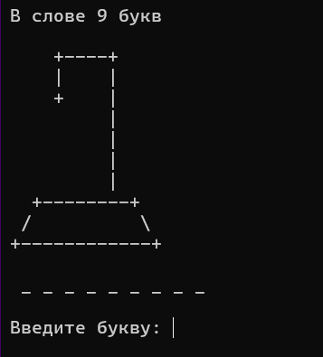
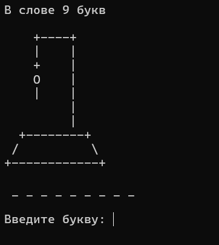
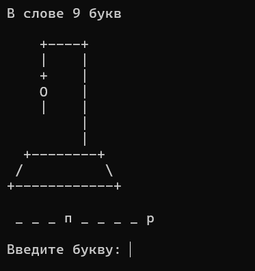

# Hangman
небольшая игра "Виселица" в консоли
Консольная игра на языке C#, реализующая классическую механику «Виселицы». Игроку необходимо угадать загаданное слово по буквам, пока не исчерпаны все попытки.

## Описание проекта

Простой учебный проект для тренировки в написании кода

## Функционал игры

- **Случайный выбор слова:** Программа выбирает слово из предустановленного массива.
- **Отображение прогресса:** Скрытые буквы заменяются на подчёркивания (`_`), а угаданные — открываются в нужных позициях.
- **ASCII-графика:** При каждой ошибке дорисовывается соответствующая часть виселицы (всего 6 частей).
- **Валидация ввода:** Программа проверяет, что пользователь ввёл ровно одну русскую букву, которая ещё не была названа ранее. Регистр не учитывается.
- **Условия победы и поражения:** Победа при полном угадывании слова, поражение — при 6 ошибках.

## Используемые технологии

- **Язык:** C#
- **Платформа:** .NET (Console Application)
- **Ключевые концепции:** 
  - Объектно-ориентированное программирование (классы, методы, инкапсуляция).
  - Коллекции (`List<char>`).
  - Работа со строками и символами (`IndexOf`, `Char.ToLower`, `Char.IsLetter`).
  - Генерация случайных чисел (`Random`).

## Как играть

1. При запуске программа сообщает количество букв в загаданном слове.
2. Введите одну русскую букву и нажмите `Enter`.
3. Если буква есть в слове — она откроется. Вы можете продолжать угадывать.
4. Если буквы нет — появится часть виселицы.
5. У вас есть **6 попыток**. Удачи!

## Как запустить проект

1. Склонируйте репозиторий (или скачайте ZIP-архив: кнопка `Code` -> `Download ZIP`).
2. Откройте файл решения (`.slnx` или `.csproj`) в Visual Studio.
3. Нажмите **F5** для сборки и запуска игры.

## Скриншоты
| Начало игры | Ошибки | Правильные буквы |
|:---:|:---:|:---:|
|  |  |  |
| Победа | Поражение |
|  |  |
